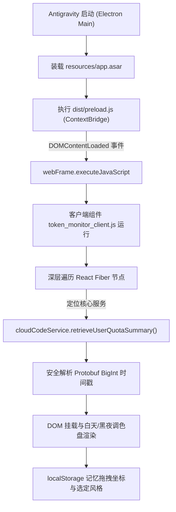

# ⚡ Antigravity Token Monitor

> **Google Antigravity 2.0 桌面端原生实时 Token / 模型配额悬浮监控插件**  
> 随软件 100% 原生自启 · 紧凑精炼双周期对照 · 白天/黑夜自适应 · 零后台常驻进程 · 自由拖拽记忆

<p align="center">
  
</p>

<p align="center">
  <a href="#-快速安装"></a>
  <a href="#-读懂你的配额数据"></a>
  <a href="#-风格一览与场景推荐"></a>
  <a href="LICENSE"></a>
</p>

---

## 📖 目录

- [🌟 为什么需要本插件](#-为什么需要本插件)
- [📊 读懂你的配额数据](#-读懂你的配额数据)
- [🚀 快速安装指南](#-快速安装指南)
  - [方式一：一键快速安装（推荐 Windows 用户）](#方式一一键快速安装推荐-windows-用户)
  - [方式二：命令行手动安装（开发者首选）](#方式二命令行手动安装开发者首选)
- [🎮 核心功能与交互操作](#-核心功能与交互操作)
  - [1. 快捷交互一览表](#1-快捷交互一览表)
  - [2. 标题栏智能淡隐机制](#2-标题栏智能淡隐机制)
  - [3. 点击即时刷新与微动反馈](#3-点击即时刷新与微动反馈)
  - [4. 全屏自由拖拽与记忆复位](#4-全屏自由拖拽与记忆复位)
  - [5. 白天/黑夜模式自适应调色盘](#5-白天黑夜模式自适应调色盘)
- [🎨 4 大视觉风格与场景推荐](#-4-大视觉风格与场景推荐)
- [⚙️ 高级配置与个性化 DIY](#️-高级配置与个性化-diy)
- [❓ 常见问题排查 (FAQ)](#-常见问题排查-faq)
- [🛡️ 安全、备份与卸载还原](#️-安全备份与卸载还原)
- [🔬 底层技术架构原理](#-底层技术架构原理)
- [📄 开源协议](#-开源协议)

---

## 🌟 为什么需要本插件

Google Antigravity 2.0 拥有极其强大的编码推理能力，但官方对配额（Quota / Token）的查看路径设计较为隐蔽，通常需要点开设置或多层折叠才能确认当前是否限流。

此外，官方配额实行**双重滑动窗口配额桶机制**（5小时短期限制 + 7天周度总量限制）。很多开发者在专注 Coding 时，经常突然遭遇 `Rate Limit Exceeded`，打乱开发节奏。

**Antigravity Token Monitor** 专为解决这一痛点而生：
- **100% 随应用原生秒开**：通过修补 Electron 预加载层，每次启动 Antigravity 窗口自动随 DOM 渲染呈现，无需额外开启聊天会话。
- **纯应用内执行，零后台消耗**：不使用任何外部 Windows 常驻服务、不使用 VBS 守护脚本、不常驻额外进程，零内存开销。
- **超精炼双周期对照**：默认采用极简水印格式，不遮挡侧边栏代码与会话目录，抬眼即见当前剩余百分比与精准倒计时。

---

## 📊 读懂你的配额数据

默认采用全新的精简等宽双周期对比格式：

```text
Gemini 70% 3h30m - 90% 6d
Claude 100% 5h - 100% 7d
```

### 格式深度拆解（以 `Gemini 70% 3h30m - 90% 6d` 为例）：

| 组成部分 | 示例值 | 含义与计算逻辑 |
| :--- | :--- | :--- |
| **模型名称** | `Gemini` | 代表 Google Gemini 官方模型池（Gemini 2.5 Pro / Flash 等） |
| **5h 短期余量** | `70%` | 当前 5 小时滑动窗口内剩余可用额度比例 |
| **5h 恢复倒计时** | `3h30m` | 距离 5 小时短周期配额下一次滑动恢复/完全重置所剩的时间（3小时30分钟） |
| **周期分隔符** | `-` | 清晰分隔短期与长期数据 |
| **每周长期余量** | `90%` | 当前 7 天周度窗口内剩余可用额度比例 |
| **周度重置倒计时** | `6d` | 距离 7 天周度配额完全刷新重置剩余的天数（6天） |

> **Claude 行同理**：`Claude` 模型池包含 Claude 3.5 Sonnet / 3.7 及 3P 扩展模型配额，同样分别呈现 5h 与 Weekly 双周期数据。

### 三级色彩预警机制
组件会根据当前剩余百分比自动变色，时刻提醒您的使用节奏：
- 🟢 **充沛健康（> 50%）**：呈现清爽翡翠绿，可放心理论大模型长上下文。
- 🟠 **配额偏紧（20% ~ 50%）**：自动转为醒目暖橙色，提示合理分配生成任务。
- 🔴 **极度濒危（≤ 20%）**：醒目深红色告警，建议暂缓大批量生成，等待滑窗倒计时恢复。

---

## 🚀 快速安装指南

### 前置条件
- 已安装 **Google Antigravity 2.0** 桌面端
- 系统环境：Windows 10 / Windows 11
- 已安装 **[Node.js](https://nodejs.org)**（推荐 LTS 版本，如 Node 18 / 20 / 22+）  
  *验证方法：在 PowerShell 或 CMD 中输入 `node -v`，能显示版本号即可。*

---

### 方式一：一键快速安装（推荐 Windows 用户）

1. 克隆或直接下载仓库 ZIP 压缩包并解压：
   ```bash
   git clone https://github.com/LaoMo-Han/antigravity-token-monitor.git
   cd antigravity-token-monitor
   ```
2. 在文件夹中**双击运行 `install.bat`**。
3. 脚本将自动执行以下操作：
   - 自动检测并安装必要解包工具 `@electron/asar`；
   - 自动定位 `%LOCALAPPDATA%\Programs\antigravity\resources\app.asar`；
   - 自动备份原始文件为 `app.asar.bak`；
   - 解包并植入监控组件代码；
   - 重新打包回 `app.asar`；
   - 若此时 Antigravity 正在运行，脚本会自动通过调试通道对当前窗口执行**无缝热更新**！

---

### 方式二：命令行手动安装（开发者首选）

如果您偏好在终端中精细掌控每一步：

```bash
# 1. 进入仓库根目录
cd antigravity-token-monitor

# 2. 安装解包工具依赖 (无需全局污染)
npm install @electron/asar --no-save

# 3. 执行自动化补丁程序
node scripts/patch_asar.js
```

---

## 🎮 核心功能与交互操作

### 1. 快捷交互一览表

| 交互目标 | 交互操作 | 效果说明 |
| :--- | :--- | :--- |
| **余量文字内容区** | **鼠标左键单击** | 立即向底层云服务强制刷新配额，组件上方微胶囊浮起「`已刷新`」提示 |
| **组件主体** | **鼠标移入 (Hover)** | 顶部控制标题栏在 **0.05s 内瞬显**，露出操作按钮 |
| **组件主体** | **鼠标移出 (Leave)** | 顶部控制标题栏在 **0.5s 内缓慢淡化为完全透明**，不挡视觉 |
| **标题栏控制区** | **鼠标左键按住拖拽** | 可将组件拖拽至屏幕任意位置悬浮放置，松开鼠标即刻记忆坐标 |
| **🎨 调色板按钮** | **鼠标左键单击** | 循环切换 4 种样式（极简水印 ➔ 经典卡片 ➔ 极简双环 ➔ 极客 HUD） |
| **⚓ 锚点复位按钮** | **鼠标左键单击** | 一键清除自定义坐标，重新吸附复位至侧边栏“系统设置”上方推荐位 |
| **🔄 刷新图标按钮** | **鼠标左键单击** | 触发带 360° 旋转动效的手动强制刷新 |
| **⌃ / ⌵ 折叠按钮** | **鼠标左键单击** | 快速收起或展开下方模型余量内容区 |

---

### 2. 标题栏智能淡隐机制

在日常编写代码时，多余的图标按钮会分散注意力。组件专为“极简水印”风格打造了平滑的透明度呼吸过渡：
- **移出时慢隐（0.5s）**：光标移开后，`TOKEN QUOTA` 标题及切换图标慢慢隐匿为 100% 完全透明，界面仅留下干净利落的 `Gemini 70% 3h30m - 90% 6d` 等宽数字。
- **移入时瞬显（0.05s）**：一旦光标靠近该区域，控制栏立刻闪现，方便快速切换风格、拖拽位置或手动刷新。

---

### 3. 点击即时刷新与微动反馈

- 点击余量区域任何文字，均会立即调用底层 `retrieveUserQuotaSummary(forceRefresh = true)` 向 Google 云端拉取最新配额。
- 刷新触发瞬间，余量内容轻微回弹（0.985 缩放微动），同时在组件正上方浮现一颗高斯模糊背景的轻量微胶囊：
  ```text
  ✓ 已刷新
  ```
  微胶囊于 1.2 秒后向上平滑消隐，整个过程行云流水，反馈清晰。

---

### 4. 全屏自由拖拽与记忆复位

- **多显示器与个性化摆放**：您不仅可以将其放置在侧边栏底部，还可以将其拖动到主编辑区右上角、终端面板顶部、副显示器等任意舒适区域。
- **原生本地持久化**：坐标通过 `localStorage.setItem('agy_token_monitor_pos', ...)` 存储，即使重启软件、重启电脑，组件依然会准确停留在您上次摆放的位置。
- **一键复位防丢失**：如果拔掉外接屏幕导致组件跑到视口之外，只需点击 ⚓ 锚点按钮（或在控制台清除 storage），组件就会瞬移回到左侧栏底部默认吸附位。

---

### 5. 白天/黑夜模式自适应调色盘

告别很多插件在白天浅色主题下“白底白字看不清”的通病：
- 内置针对 `document.body` class 的 `MutationObserver` 主题监听器。
- **白天模式（Light Theme）**：字色自动切换为经过无障碍对比度调校的**深墨灰**（`rgba(15, 23, 42, 0.90)`），文字锐利立体、绝不发飘发白。
- **黑夜模式（Dark Theme）**：自适应呈现高科技暗调莹光色，与 Antigravity 原生暗色界面天衣无缝融合。

---

## 🎨 4 大视觉风格与场景推荐

点击标题栏上的 🎨 图标即可在 4 种风格中自由切换，各风格均共享同一个后台单例拉取器，切换零延迟：

### 1. 极简水印 (Watermark) · 默认推荐
- **视觉特征**：无边框、无背景底色、无投影，完全融入当前界面底色，仅保留核心等宽数据。
- **最佳场景**：常驻侧边栏“系统设置”上方，或悬浮在代码区边缘，极度清爽耐看。

### 2. 经典卡片 (Classic)
- **视觉特征**：自适应侧边栏容器背景，带有精细的 4px 圆角微型色彩进度条。
- **最佳场景**：偏好图形化进度展示、喜欢传统 Dashboard 质感的用户。

### 3. 极简双环 (Radial)
- **视觉特征**：采用 SVG 矢量圆环仪表盘排版，内环呈现 5h 限额，外环呈现周度限额。
- **最佳场景**：高分辨率 2K / 4K 宽屏显示器，拖拽到工具栏或空闲区域作为精致的数字微仪表。

### 4. 极客 HUD (Cyber)
- **视觉特征**：赛博朋克深黑毛玻璃、科技蓝边框光晕、内发光矩阵磁贴。
- **最佳场景**：全屏暗黑模式沉浸式编程，放置在副屏幕角落充当极客状态看板。

---

## ⚙️ 高级配置与个性化 DIY

如果您希望自定义轮询间隔或微调样式，只需编辑 [scripts/token_monitor_client.js](scripts/token_monitor_client.js) 后重新执行 `node scripts/patch_asar.js`：

### 1. 调整后台自动静默刷新间隔
默认为 30 秒轮询一次，可在代码中搜索 `30000` 进行修改：
```javascript
// 修改自动轮询频率 (单位: 毫秒)
const pollTimer = setInterval(() => {
  fetchQuota(false, false);
}, 60000); // 改为 60 秒轮询一次
```

### 2. 修改默认启动风格
如果希望一开机就默认使用“经典卡片”或“极客 HUD”：
```javascript
// 0: 极简水印, 1: 经典卡片, 2: 极简双环, 3: 极客 HUD
let currentStyleIdx = 1; // 修改为 1 即可默认卡片
```

### 3. 调整标题栏淡出时间
搜索 `agy-token-anim-style`，修改 CSS transition 时间：
```css
/* 鼠标离开组件时，最上一栏隐匿过渡时间 (如从 0.5s 改为 1s) */
#agy-token-monitor-widget.agy-style-watermark #agy-token-header {
  transition: opacity 1.0s cubic-bezier(0.4, 0, 0.2, 1) !important;
}
```

---

## ❓ 常见问题排查 (FAQ)

### Q1: Antigravity 官方客户端在线静默升级后，监控组件不见了？
**解答**：Antigravity 官方发布全新版本时，可能会下载全新的 `app.asar` 替换旧文件。此时只需重新双击运行本项目目录下的 **`install.bat`**，即可在 3 秒内重新完成注入，恢复全部监控！

### Q2: 运行 install.bat 时提示 `找不到 @electron/asar` 怎么办？
**解答**：请确保电脑上已正确安装 Node.js。若网络受限导致 npm 下载慢，可先设置国内镜像后重试：
```bash
npm config set registry https://registry.npmmirror.com
install.bat
```

### Q3: 为什么不需要在 Windows 开机启动文件夹里放任何开机脚本？
**解答**：因为本组件采用了**原生预加载层（Preload）植入方案**。监控代码已经封包在 Antigravity 客户端自身的生命周期中，只要 Antigravity 主程序打开，它就会自然在渲染进程中执行，因此系统后台没有任何额外的常驻进程，彻底杜绝资源浪费。

### Q4: 拖拽到副屏后拔下外接屏幕，找不到悬浮窗了？
**解答**：直接在 Antigravity 中按下快捷键 `Ctrl + Shift + I`（或 `F12`）打开控制台 Console，输入以下代码并回车，组件将立即自动归位复位：
```javascript
window.__AGY_TOKEN_MONITOR__.resetPosition();
```

---

## 🛡️ 安全、备份与卸载还原

本插件秉持**安全、纯净、绝不收集隐私**的开源准则：
- **纯本地数据交互**：所有配额数据均通过客户端本地 React Fiber 挂载的 `cloudCodeService` 获取，不上传任何对话内容、不连接任何第三方中转服务器。
- **自带一键无损备份**：安装脚本在初次运行时，会自动在同目录下克隆一份未经任何修改的原版主包：  
  `%LOCALAPPDATA%\Programs\antigravity\resources\app.asar.bak`

### 彻底卸载与还原官方原版：
若您在任何时候希望卸载本插件、完全还原为官方纯净版：
1. 完全退出 Antigravity 应用程序；
2. 按 `Win + R` 键，输入并打开目录：  
   `%LOCALAPPDATA%\Programs\antigravity\resources\`
3. 删除当前的 `app.asar` 文件；
4. 将备份的 `app.asar.bak` 重新命名为 `app.asar` 即可，软件将 100% 恢复如初。

---

## 🔬 底层技术架构原理

对于喜欢探索底层机制的开发者，本插件的技术链条如下：



1. **Fiber 树动态穿透**：通过遍历界面根节点各组件的 `__reactFiber$` 属性，定位 `memoizedProps.services.core.cloudCodeService` 单例对象，直接复用 Antigravity 原生与 Google 后端通信的高速 gRPC-Web / Protobuf 隧道。
2. **BigInt 运算保护**：底层重置时间戳（`resetTime.seconds`）在 Protobuf 序列化中为原生 JS `BigInt`。组件内部全部采用 `Number(sec)` 安全装换，避免与 `Date.now()` 发生 `TypeError: Cannot mix BigInt and other types` 异常。
3. **CDP 动态免重启热装载**：脚本读取系统 `%LOCALAPPDATA%\Antigravity\DevToolsActivePort` 中记录的调试端口，通过 WebSocket 向当前打开的窗口下发 `Runtime.evaluate` 指令，实现代码修改后无需重启软件即可秒级生效。

---

## 📄 开源协议

本项目基于 [MIT License](LICENSE) 协议完全开源。欢迎 Star、Fork 或提交 Issue / Pull Request 一同完善！

*Made with ❤️ for Google Antigravity Developers.*
